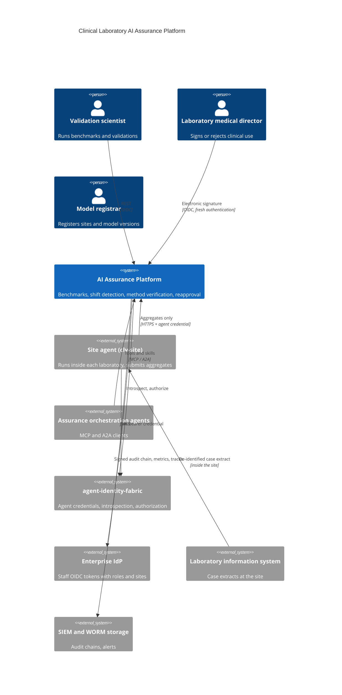
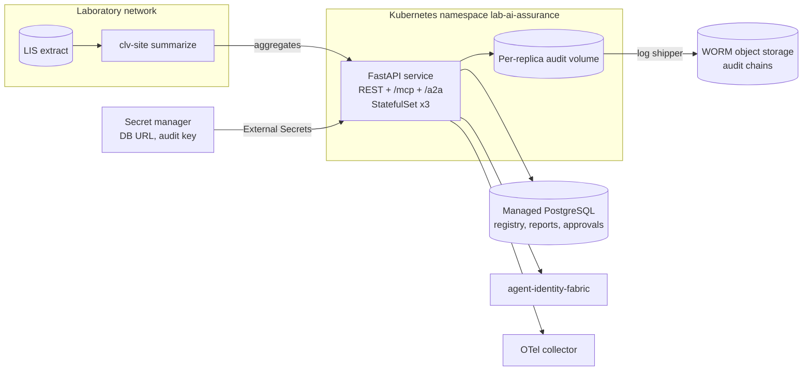
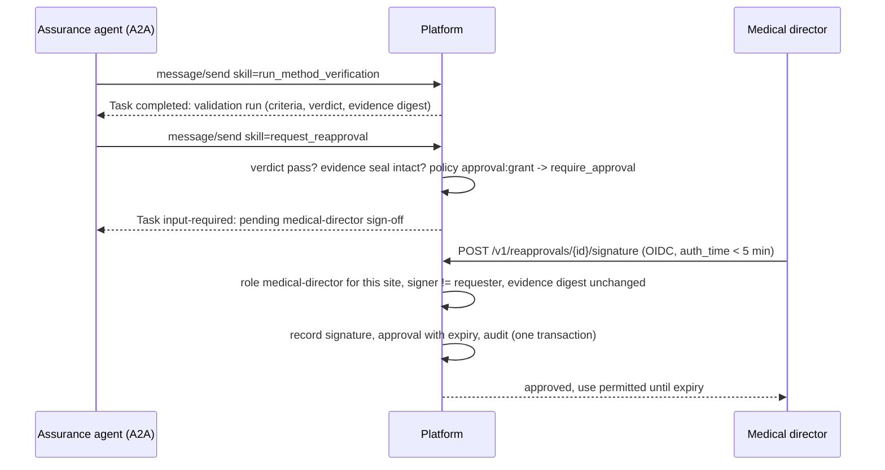
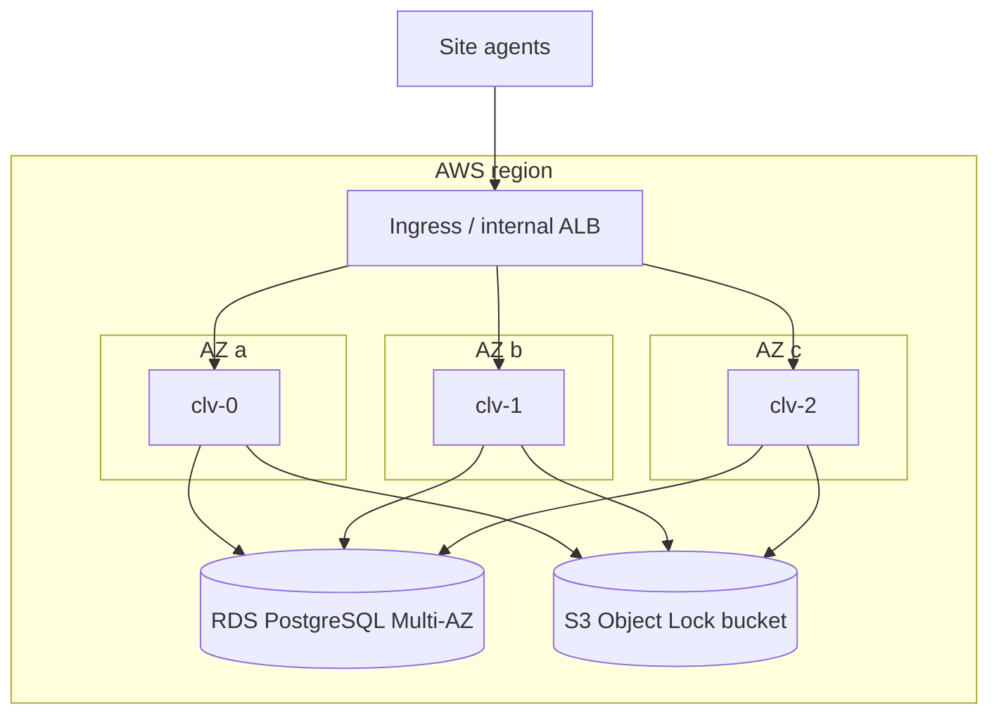

# Architecture

## Business problem

Laboratory AI models (risk scores from routine chemistry, digital morphology
classifiers, flagging models) are validated on a development population and
then deployed to laboratories whose patients, analysers and reagent lots
differ. Under CLIA (42 CFR 493.1253) and CAP checklist requirements, each
laboratory must verify performance specifications before reporting patient
results, and the laboratory director is accountable for that decision.
Today this is a spreadsheet exercise repeated per site, rarely revisited when
the population drifts, and difficult to audit. Sharing case-level data
between sites to compare performance is often not permitted.

The platform turns this into a governed, repeatable workflow:

1. A model version is registered once, with its validation protocol and
   reference population.
2. Each site benchmarks the model on its own cases and submits only
   aggregate statistics.
3. Shift detection compares the site's population with the reference and
   with itself over time.
4. The validation protocol is evaluated with CLIA/CAP-style method
   verification studies.
5. A medical director of that site signs, or rejects, clinical use. A major
   population shift withdraws use automatically until revalidation.

## System context (C4 level 1)



## Containers (C4 level 2)



## Components (C4 level 3)

| Layer | Module | Responsibility |
|---|---|---|
| API | `api.app`, `api.routes` | HTTP contract, OAuth-style errors, correlation IDs, metrics, mounts MCP |
| Agent protocols | `protocols.mcp_server`, `protocols.a2a`, `protocols.skills`, `protocols.invoke` | MCP tools and A2A skills over one skill registry; authenticate, meter and audit every call |
| Application | `application.service.AssuranceService` | Use cases: registry, benchmark, shift, validation, reapproval request, signature; authorization and audit around every step |
| Statistics | `evaluation.classification`, `shift`, `method_verification`, `special`, `reports` | The methods in [statistical-methods.md](statistical-methods.md); report builders that validate aggregates against the model specification |
| Domain | `domain.models`, `domain.aggregates` | Sites, model versions, protocols, approvals and their state machines; aggregate schemas that forbid unknown fields |
| Federation | `federation.summarize`, `client`, `cli` | Site-side summarisation and submission with an agent credential |
| Security | `security.authentication`, `authorization`, `jwks`, `text_guard` | Staff OIDC, agent introspection or local verification, local policy combined with the fabric, PHI and secret guard on free text |
| Integrations | `integrations.identity_fabric` | Typed client for `/oauth2/token`, `/oauth2/introspect`, `/v1/authorize` |
| Infrastructure | `infrastructure.database` | SQLAlchemy Core store (PostgreSQL in production, SQLite in tests) |
| Runtime | `runtime.container` | Composition root built from settings |

## Sequences

### Benchmark and shift from a site

```mermaid
sequenceDiagram
  participant S as clv-site (inside the lab)
  participant F as Identity fabric
  participant P as Assurance platform
  S->>S: read case extract (model columns only), build histograms
  S->>F: POST /oauth2/token jwt-bearer (projected workload token)
  F-->>S: agent credential, scopes benchmark:run shift:analyze site:access:<site>
  S->>P: POST /v1/benchmarks (aggregate) + credential
  P->>F: POST /oauth2/introspect
  P->>F: POST /v1/authorize (benchmark:run, site-model)
  P->>P: local policy; most restrictive decision wins
  P->>P: validate aggregate vs model spec, compute report, audit
  P-->>S: benchmark report (Wilson CIs, AUROC bootstrap, ECE, subgroups)
  S->>P: POST /v1/shift-analyses (population aggregate)
  P->>P: PSI, KS, chi-square, BBSE; major shift restricts approval
  P-->>S: shift report
```

### Validation and reapproval



### Fail-safe restriction

A shift analysis classified `major` for a site whose approval is currently
permitted moves that approval to `revalidation_required` in the same request,
after the `approval:restrict` policy check. Restricting use is the safe
direction, so it does not wait for a human; restoring use always does.

## Agent protocols

### MCP

The official `mcp` SDK (2.x `MCPServer`, the successor of FastMCP) serves
streamable HTTP at `/mcp`, stateless with JSON responses so any replica can
serve any call. DNS-rebinding protection checks `Host` and `Origin` against
the public URL. Tools, each with input and output JSON Schema:

| Tool | Input | Output | Annotations |
|---|---|---|---|
| `list_site_approvals` | `SiteQuery` | `ApprovalList` | read-only, idempotent |
| `benchmark_site_performance` | `BenchmarkCommand` | `BenchmarkReport` | |
| `detect_population_shift` | `ShiftCommand` | `ShiftOutcome` | |
| `run_method_verification` | `ValidationCommand` | `ValidationRun` | |
| `request_reapproval` | `ReapprovalCommand` | `ReapprovalRequest` | |

The caller is authenticated from the MCP request's `Authorization` header,
authorized per action and audited (`mcp.<tool>` events plus the use-case
events). There is no signing tool.

### A2A

`/.well-known/agent-card.json` publishes name, description, URL, version,
capabilities, skills (the same five) and security schemes (bearer agent
credential, staff OpenID Connect). `POST /a2a` implements JSON-RPC 2.0
`message/send`: the message carries a data part
`{"skill": "<id>", "input": {...}}`. Results come back as a Task whose state
reflects governance: `completed`, `input-required` (reapproval waiting for a
human), `rejected` (policy) or `failed` (invalid evidence). Unauthenticated
calls receive HTTP 401 with a JSON-RPC error.

## Deployment view



Replicas spread across zones; the PDB keeps two available during voluntary
disruption; PostgreSQL is Multi-AZ. Each replica writes its own audit chain
to a persistent volume, shipped to Object Lock storage.

## Data

| Store | Data | Classification | Retention |
|---|---|---|---|
| `sites`, `model_versions` | Registry, protocols, reference aggregates | INTERNAL | Life of model + 7 years |
| `reports` | Benchmark, shift and validation reports (append-only) | CONFIDENTIAL | 7 years (laboratory records) |
| `reapprovals`, `approvals` | Requests, signatures, approval state | CONFIDENTIAL | 7 years |
| Audit chains | Every decision and state change | CONFIDENTIAL | 7 years, WORM |

No table holds case-level patient data. Free-text fields (justification,
signature statement) are rejected if they contain identifiers or
credentials.

## Observability

| Signal | Detail |
|---|---|
| Metrics | `clv_http_request_duration_seconds`, `clv_evaluations_total{kind,outcome}`, `clv_shift_analyses_total{severity}`, `clv_approvals_restricted_total`, `clv_reapproval_signatures_total{meaning}`, `clv_authorization_denials_total{code}`, `clv_agent_protocol_calls_total{protocol,operation,outcome}` |
| Traces | OpenTelemetry FastAPI instrumentation, OTLP export |
| Logs | JSON with correlation ID and sensitive-key scrubbing (agentic-core) |
| Alerts | `configs/prometheus/alerts.yaml`: error-budget burn, evaluation latency, major shift, approval withdrawn, validation failures, denial spike, agent-protocol errors, replicas down |
| Dashboard | `configs/grafana/cross-lab-ai-validation.json` |

## CI/CD

`.github/workflows/ci.yml`: lint, format, `mypy --strict`, bandit, contract
drift, all test suites with a 90% coverage gate on Python 3.12 and 3.13,
`pip-audit`; PostgreSQL integration; Helm lint, required-values check and
kubeconform; Terraform fmt/validate for AWS, Azure and GCP; Trivy config
scan; container build, smoke test, Trivy image scan, Syft SBOM and Grype
gate; Semgrep. `release.yml` on a `v*` tag re-runs the gate, checks the tag
against the package and chart versions, pushes the image with provenance
attestation, pushes the chart to GHCR OCI and publishes a release with the
SBOM.
